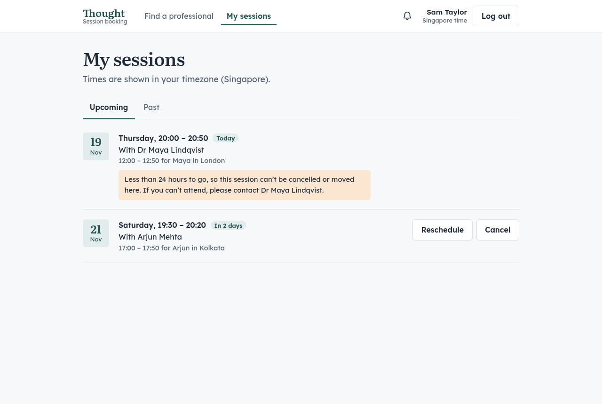
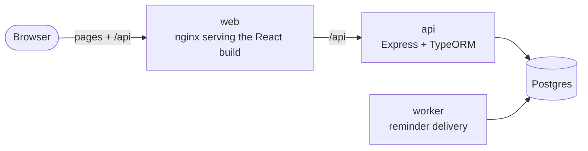

# Thought

Session booking with reminders.

Thought is a small, working version of a booking flow for a mental-health platform. Members find a
professional, pick a time from a 4-week calendar shown in their own timezone, confirm, and book a
50-minute session. Both people get in-app reminders 24 hours and 1 hour before it starts.

The parts that make this harder than it looks are handled in the database and tested directly:
no double-booking even under concurrent requests, timezones and daylight saving changes, the
24-hour change rule, and reminders delivered exactly once across restarts.
See [DECISIONS.md](DECISIONS.md) for how and why, and [AI_USAGE.md](AI_USAGE.md) for how AI was used.

| Booking calendar (member in Singapore, professional in Kolkata) | Confirmation |
| --- | --- |
|  |  |
| **My sessions** (inside 24 hours, changes are locked with a clear reason) | **Availability** (each range previews the session times it creates) |
|  |  |

More in [docs/screenshots](docs/screenshots/): sign-up, notifications, the professional's schedule, mobile.

## Quick start

**Prerequisite:** Docker with Compose v2.

```bash
docker compose up --build
```

| What | Where |
| --- | --- |
| The app | http://localhost:3000 |
| API documentation (Swagger UI) | http://localhost:4000/api/docs |

The first start creates fictional demo accounts. The password for all of them is `password123`.

| Email | Role | Timezone | Good for trying |
| --- | --- | --- | --- |
| `sam@example.com` | Member | Singapore | One session inside 24 hours (locked), one that can be changed |
| `priya@example.com` | Member | Los Angeles | Booking across a large time difference |
| `maya@example.com` | Professional | London | Schedule with member names, availability editor |
| `arjun@example.com` | Professional | Kolkata (UTC+5:30) | Half-hour offset |
| `sofia@example.com` | Professional | New York | Daylight saving time zone |

You can also sign up as a new member or professional.

## Running the tests

```bash
docker compose run --rm test
```

This runs 94 backend tests against a real Postgres database (a separate `booking_test` database):

- **Unit tests** (`backend/test/unit`): slot generation, timezones and daylight saving changes,
  the 24-hour rule, reminder planning, password hashing.
- **Integration tests** (`backend/test/integration`): the API end to end, including 10 members
  booking the same slot at once (exactly one wins), concurrent reschedules, reminder delivery with
  parallel workers and after downtime, refresh-token rotation, and access control.

Without Docker for the tests themselves: start only the database with `docker compose up -d db`,
then `cd backend && npm install && npm test`.

## Local development

```bash
docker compose up -d db                      # Postgres on localhost:5433

cd backend
npm install
npm run seed                                 # optional: demo accounts
npm run dev                                  # API on http://localhost:4000
npm run dev:worker                           # reminder worker (second terminal)

cd ../frontend
npm install
npm run dev                                  # app on http://localhost:5173 (forwards /api to :4000)
```

Settings are environment variables with local defaults; see [backend/.env.example](backend/.env.example).

## Architecture



- **web**: the React app (Vite build) served by nginx, which forwards `/api` to the API so the
  browser only talks to one origin.
- **api**: Express 5 + TypeScript. Validates input with zod, identifies the caller from a JWT
  access token on every request, and runs every change in a database transaction.
- **worker**: a separate process that polls for due reminders every 10 seconds and turns each into
  an in-app notification exactly once. All its state is in the database, so restarts lose nothing.
- **db**: Postgres 16. It also enforces the rules that must never break, such as "no two booked
  sessions overlap for the same professional or the same member" (exclusion constraints).

All times are stored in UTC. Working hours are stored as local wall-clock times in the
professional's timezone and turned into exact times per date, which is what keeps "Monday 09:00"
at 09:00 local across daylight saving changes.

### Folder structure

```
backend/
  src/
    app.ts  server.ts  worker.ts  config.ts
    modules/                     one folder per feature
      auth/                      sign up, log in, tokens, who is calling
      availability/              weekly hours, days off, slot generation
      professionals/             list, profile, free slots
      sessions/                  book, cancel, reschedule (+ the 24-hour rule)
      notifications/             reminders and the in-app notification list
    common/                      errors, clock, timezones, shared validation
    db/                          connection, migrations, demo seed
  test/unit  test/integration
  openapi.yaml                   API documentation
frontend/
  src/
    api/                         the one fetch wrapper (+ token refresh) and API types
    auth/  professionals/  sessions/  availability/  notifications/
    components/  lib/  styles.css
docs/screenshots/
```

Each feature folder holds its `*.routes.ts` (the endpoints), `*.schema.ts` (request validation),
and one `*.model.ts` per table, with any real logic in a plainly named file next to them
(for example `availability/slots.ts`, `sessions/booking.ts`). Every file starts with a short
comment saying what it contains and what it is for.

## How the brief maps to the code

| Requirement | Where | Tested in |
| --- | --- | --- |
| Sign up, log in, log out; user from token, never from client ids | `modules/auth` | `auth.test.ts`, `access.test.ts` |
| Weekly working hours in the professional's timezone | `modules/availability` | `availability.test.ts`, `weekly-hours.test.ts` |
| Slot generation and layout | `availability/slots.ts` | `slots.test.ts` |
| Calendar for 4 weeks in the member's timezone | `professionals.routes.ts`, `SlotPicker.tsx` | `booking.test.ts`, `slots.test.ts` |
| No double-booking, no overlapping sessions, no past slots | migration `003_sessions.ts`, `sessions/booking.ts` | `booking.test.ts` |
| My sessions / professional's schedule with member names | `sessions.routes.ts` | `booking.test.ts`, `access.test.ts` |
| Cancel and reschedule, 24-hour rule, never zero or two sessions | `sessions/booking.ts` | `changes.test.ts`, `rules-and-reminders.test.ts` |
| Reminders 24h and 1h before, exactly once, survive restarts | `notifications/reminders.ts`, `worker.ts` | `reminders.test.ts` |
| Persistence | Postgres + migrations | all integration tests |
| Access control and privacy | every query scoped to the caller | `access.test.ts` |
| Extras: days off, minimum notice (2 hours), one `docker compose up` | | `booking.test.ts` |
